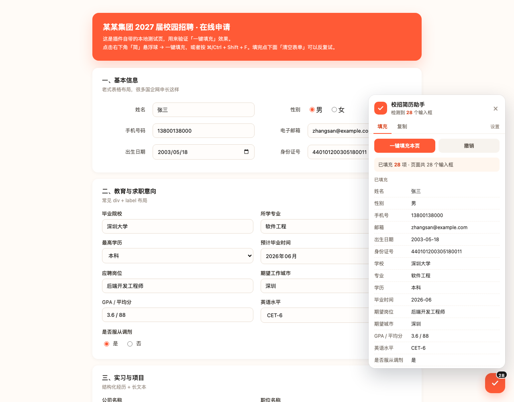
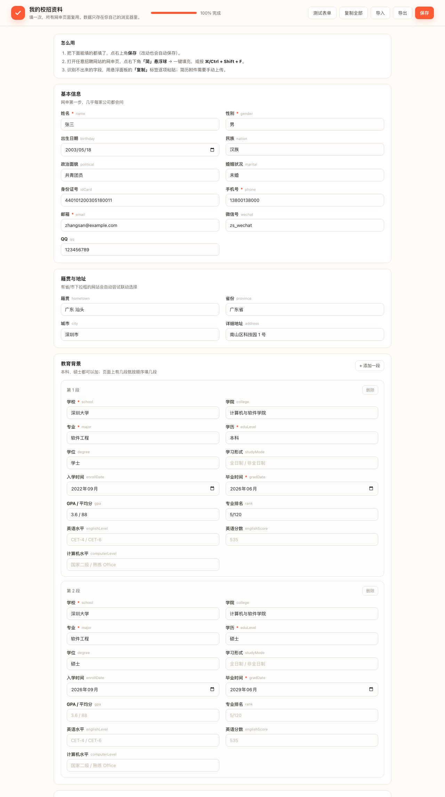
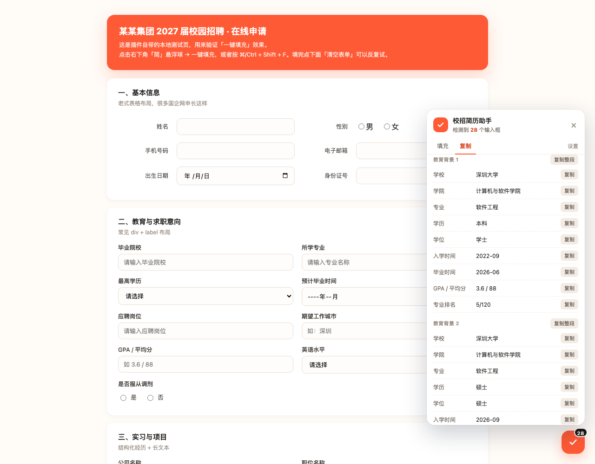

<div align="center">
  
  <h1>HappyJob</h1>
  <p>校招网申一键填充。资料填一次，之后每个招聘页按一下快捷键。</p>

  <p>
    
    
    
  </p>
</div>



## 为什么写这个

秋招那阵子，改简历反而是最轻松的环节。真正耗时间的是把简历里的东西一个字一个字敲进各家的网申系统：姓名、手机、身份证、学校、专业、毕业时间、GPA、实习公司、项目描述、自我评价，每家都要重新问一遍，每家的表单组件还都不一样。

一天投五家，两三个小时就没了。更烦的是容易错。毕业时间这家要 `2026-06`，那家要 `2026年6月`；身份证号敲错一位，自己都发现不了。

HappyJob 只做一件事：把已经存好的资料，填进当前那张表单。它不生成简历，也不替你投递。

## 安装

```bash
git clone git@github.com:Wayneway26/HappyJob.git
```

打开 `chrome://extensions/`，右上角开「开发者模式」，点「加载已解压的扩展程序」，选仓库根目录（能看到 `manifest.json` 的那一层）。

Chrome / Edge 100 以上都行。还没上商店，所以只能这样装。

> 装好之后扩展列表里显示的名字是「校招简历助手」，图标是米白底加一个橘红色的勾。

第一次装完会自动打开资料页，把信息填一遍。之后就不用再管它了。

## 用起来是什么样

打开网申页，右下角会浮一个圆形按钮，上面写着识别到的字段数。点开是一键填充，也可以直接按 `⌘ + Shift + F`（Windows 上 `Ctrl + Shift + F`）。

填完面板会列出每一项填了什么，扫一眼就知道有没有填歪。

已经手写的格子不会被覆盖，这是默认行为，不用设置。填错了点「撤销」，回到上一次填充前的状态。



## 认不出来的字段

再好的规则也有认不出的时候。Ant Design、Element 那种自定义下拉，DOM 里根本没有真的 `<select>`，脚本没法给它赋值，谁来做都一样。

面板的「复制」标签页把所有资料列成一张清单，每项一个复制按钮，手动粘过去。比重新打字快。

有些问题每家都问，但问法不一样，比如「是否接受调剂」「从哪了解我们」。资料页底部可以自己加字段，填的标签会直接当成匹配关键词用。



## 它是怎么认字段的

没给任何网站写死选择器。那种写法改一次版就废。

做法是给每个字段配一组关键词，再看页面上每个控件的上下文：`name`、`id`、`placeholder`、`aria-label`、`<label for>`、表格左边那一格、外面一层的文案。命中属性加 12 分，命中标签加 10 分，只在附近文案里出现加 5 分；弱关键词减半；「验证码」「紧急联系人」「公司名称」这类容易误伤的词直接扣 30。

分数到 9 分以上、并且资料里确实有值，才写。

关键词越长加分越多，所以「期望工作城市」不会被更短的「城市」抢走。这条是踩出来的，一开始所有输入框都填成了「深圳」。

写入用原生 setter，再派发 `input` 和 `change`。直接改 `.value` 对 React 没用，框架的 state 不会跟着变，页面看着填上了，一提交全空。

下拉框按选项文字匹配，先精确、再包含、最后拆年月；省市级联会在 500ms 和 1400ms 各补一次，等上一级渲染完。日期框按 `type` 转成对应格式。

## 覆盖的字段

| 分类 | 字段 |
| --- | --- |
| 基本信息 | 姓名、性别、出生日期、民族、政治面貌、婚姻状况、身份证号、手机号、邮箱、微信号、QQ |
| 籍贯与地址 | 籍贯、省份、城市、详细地址 |
| 教育背景 | 学校、学院、专业、学历、学位、学习形式、入学时间、毕业时间、GPA / 平均分、专业排名、英语水平、英语分数、计算机水平 |
| 求职意向 | 期望岗位、期望城市、期望薪资、到岗时间、信息来源、是否服从调剂 |
| 实习经历 | 公司 / 单位、职位、开始时间、结束时间、工作内容 |
| 项目经历 | 项目名称、担任角色、开始时间、结束时间、项目描述 |
| 其他 | 校园经历、获奖情况、技能特长、自我评价、作品集、紧急联系人、紧急联系人电话 |

自定义字段不限条数。教育经历和实习经历也能加多段——页面上有几段就按顺序填几段，比如本科和硕士各填一条。

## 几个限制

简历附件传不了。`<input type="file">` 的值受浏览器安全策略保护，脚本碰不到，这是浏览器的规矩，不是没做。每次都得手动选一次文件。

自定义下拉填不了，前面说过，用复制模式。

验证码不碰。技术上能做，但不该做。

跨域 iframe 里能填，但悬浮面板只在主框架显示。遇到填不上的，用弹窗里的按钮再试一次。

资料只存本地，不同步。换电脑用资料页的「导出」和「导入」，JSON 文件自己保管好，里面有身份证号。

规则是猜的，不是查表。遇到命名奇怪的网站可能填错，提交前扫一眼。

## 隐私

所有资料存在 `chrome.storage.local`，就在你这台电脑的浏览器里：

```
~/Library/Application Support/Google/Chrome/<Profile>/Local Extension Settings/<扩展ID>/
```

没有账号，没有服务器，没有埋点，不加载远程代码。整个仓库搜不到一个 `fetch`，可以自己 grep。

公用电脑用完，资料页底部「清空全部」会把存储一起清掉。

## 开发

```bash
npm install     # 只为测试装 jsdom，扩展本身零依赖
npm test        # 四组测试
```

测试跑在 jsdom 上，是真的 DOM，不是 mock：

- `fill.test.mjs`：拿 `demo/form.html` 跑一遍完整填充，断言 28 个字段全部命中且值正确
- `tricky.test.mjs`：专门试干扰项。「公司名称」不能填成姓名，「验证码」不能填成手机号，「紧急联系人姓名」不能填成本人，已经填好的不能被覆盖
- `ui.test.mjs`：悬浮球 → 打开面板 → 填充 → 撤销
- `pages.test.mjs`：资料页渲染、自动保存、自定义字段、弹窗初始化
- `multi.test.mjs`：两段实习按顺序填进两个区块，旧版单条数据自动迁移成第一段

改完规则跑一遍，比手点十个网站快。

```
manifest.json            MV3 配置
src/lib/schema.js        字段定义、匹配关键词、存储读写
src/content/content.js   页面侧：识别、填充、悬浮面板
src/background.js        快捷键、跨 frame 广播
src/popup/               点图标弹出的面板
src/options/             资料编辑页
demo/form.html           模拟网申页，练手用
test/                    jsdom 测试
```

## 还没做的

- 上架 Chrome Web Store 和 Edge Add-ons
- 给北森、Moka、牛客这些常见系统做站点级适配
- 存多份资料，按岗位切换（后端版、算法版各一份）
- 填充前先预览，逐项确认再写
- 从 PDF 简历里解析，直接填进资料页

## 遇到问题

哪个网站填不上，开个 issue，附上这三样就行：

1. 网站域名（不方便说就脱敏）
2. 那个字段的 HTML，右键 → 检查 → 复制 outerHTML
3. 你希望填什么，实际填成了什么

只改关键词的话，动 `src/lib/schema.js` 里对应字段的 `strong` / `weak` / `negative` 数组，跑一遍 `npm test` 确认没弄坏别的，就可以提 PR 了。

## License

[MIT](LICENSE)
